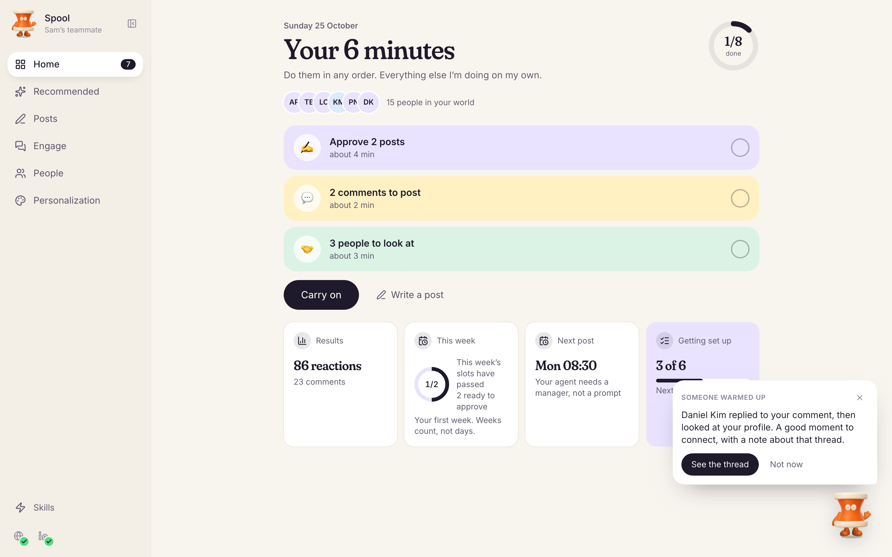
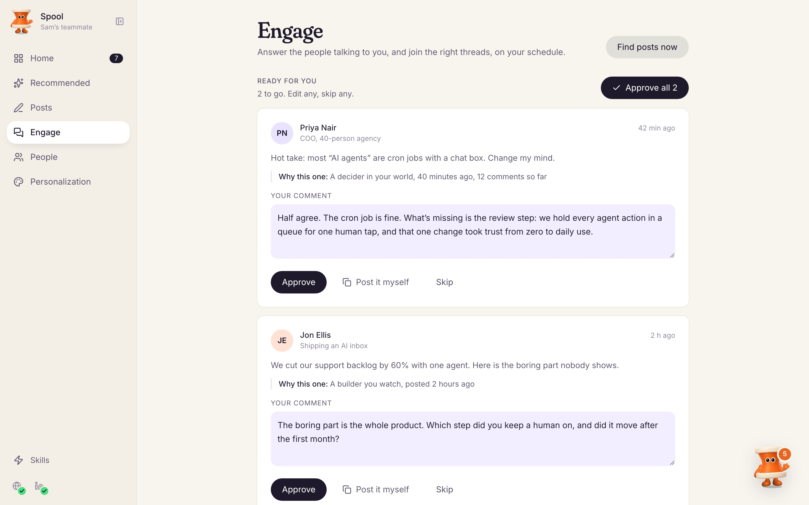
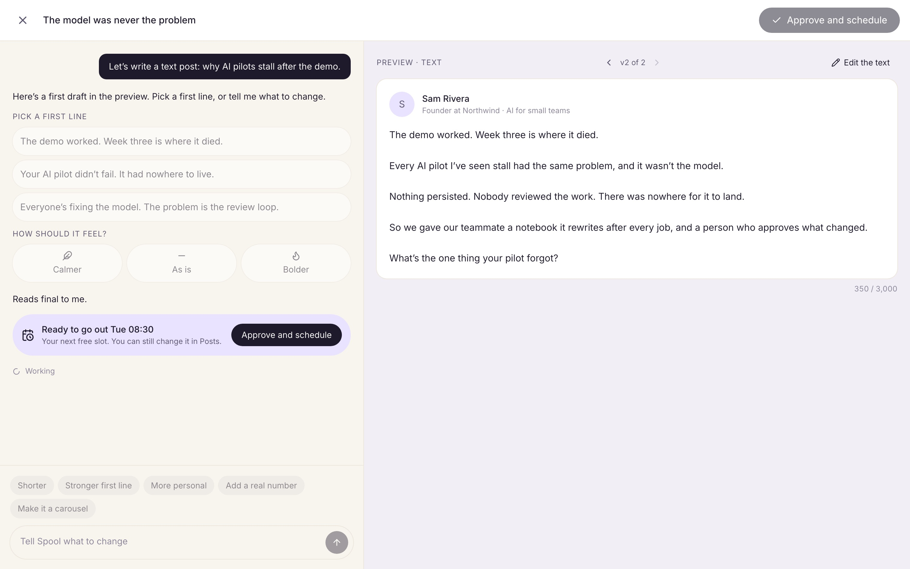
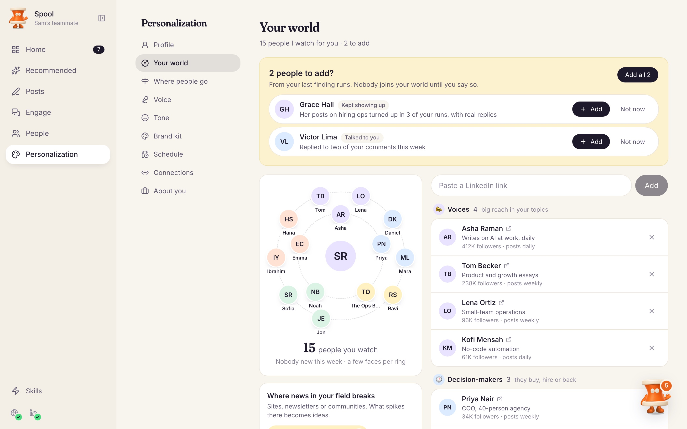
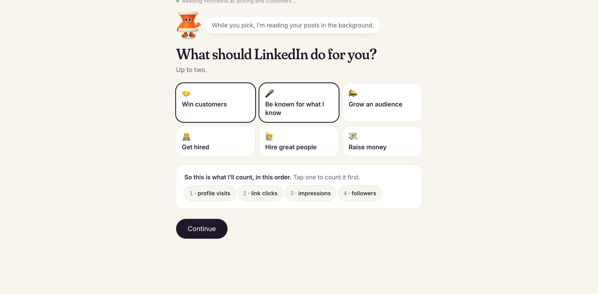
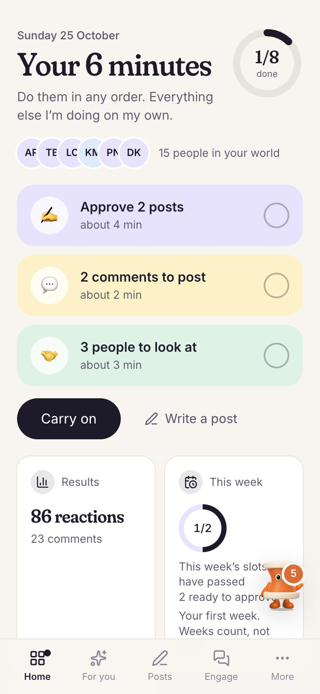
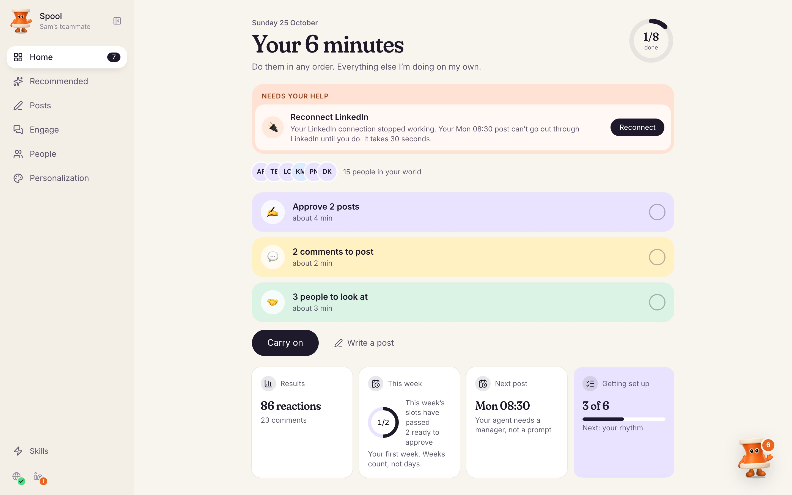

<p align="center">
  
</p>

<p align="center">
  
</p>

<h1 align="center">LinkedIn Teammate</h1>

<p align="center">
  <strong>A growth hire for your LinkedIn. Ten minutes of you a day.</strong>
</p>

<p align="center">
  Spool learns how you write and who matters to you, drafts your posts, finds the threads worth joining,<br />
  and tells you who just warmed up. You approve. It does the rest, at a human pace.
</p>

<p align="center">
  <a href="https://lemma.work/import/github/wineforyourplate/linkedin-teammate">
    
  </a>
</p>

<p align="center">
  <a href="#a-day-with-spool">A day with Spool</a>
  ·
  <a href="#what-it-does">What it does</a>
  ·
  <a href="#install-and-remix-">Install</a>
  ·
  <a href="#make-it-yours">Remix it</a>
</p>

---

## A day with Spool

Most LinkedIn tools hand you a scheduler and a blank page. A good growth hire does the work and asks
for your judgment only where it counts. That is the whole idea.

1. **Open Home.** Your ten minutes are waiting as a few coloured blocks: posts to approve, comments to
   post, people to look at, one quick question. A ring fills as you go.
2. **Approve, edit or skip.** Every post and comment is drafted in your voice, with the reason it's
   worth your time. Nothing goes out under your name until you say so.
3. **Close the app.** Spool publishes at your times, reads what landed, and brings the next batch.
4. **Hear what moved.** Spool sits in the corner and speaks up when it matters: someone replied, then
   looked at your profile; people in your world are arguing about your topic; a connection broke and
   needs one tap.

<table>
  <tr>
    <td width="50%">
      
      <br /><strong>Join the right threads, early</strong><br />
      Fresh posts from people you care about, a comment that takes a position, and why this one.
      Approve all, edit any, skip any.
    </td>
    <td width="50%">
      
      <br /><strong>Write with Spool, not a template</strong><br />
      Pick a first line, make it calmer or bolder, select any sentence to rework it. Earlier versions
      stay one tap away.
    </td>
  </tr>
  <tr>
    <td width="50%">
      
      <br /><strong>Your world, on one page</strong><br />
      The voices, decision-makers, builders and peers Spool watches for you. It suggests a few new
      people a week; nobody joins until you press Add.
    </td>
    <td width="50%">
      
      <br /><strong>Five minutes to get going</strong><br />
      A short onboarding in four chapters: you, what you want, your world, your start. Spool reads
      your profile and site in the background while you pick.
    </td>
  </tr>
</table>

<p align="center">
  
</p>

<p align="center">
  <sub><strong>Made for your phone too.</strong> Your ten minutes fit in a coffee queue.</sub>
</p>

## What it does

Each job is a skill you switch on when you're ready. Start with one; add the rest as you trust it.

| Skill | What you get |
| --- | --- |
| **Post for me** | Posts in your voice on your rhythm: text, image, link, swipeable PDF carousels and claim images in your brand kit. Each one says why now. |
| **Join conversations** | Fresh posts from your world and your topics, with a comment that adds something. Replies to you come first. |
| **Find my people** | A short list of people worth knowing, from who engages with you and who posts about your problem. |
| **Send connection requests** | A short, personal note with each request, only to people you approved, inside safe weekly limits. |
| **Follow up** | Messages that keep a real conversation going, drafted for you to approve. |
| **Warm up my account** | Gentle, human-paced activity for a new or quiet account. |
| **Optimize my profile** | Concrete edits to your headline, about and featured section, scored and explained. |

Every Monday you get a short review: what worked, what didn't, and the plan for the week. Spool
researches your topics every week, so your ideas come from what people are saying now, with dates
and links.

## Two ways in, both yours

- **Your LinkedIn connection.** Connect LinkedIn once on LinkedIn's own screen. Text, image and link
  posts then go out through LinkedIn's official API, even when your browser is signed out. No
  password is stored.
- **Your own private browser.** Reading LinkedIn (finding posts, replies and people) happens in a
  browser that is yours alone, signed in by you. Spool never sees your password and works at a
  human pace.

If either one stops working, Home shows **Needs your help** with the one tap that fixes it, and Spool
sends you one message.

<p align="center">
  
</p>

## Safe by design

- **Nothing goes out under your name without your approval:** posts, comments, invitations, messages.
- **Daily caps you can see and change,** shared across every skill, with ramps for new accounts.
  Anything held back is postponed to tomorrow, never dropped.
- **Stops at the first sign of trouble.** At a login wall, checkpoint, captcha or warning, everything
  on LinkedIn stops and you get one message.
- **Only the API calls LinkedIn allows.** The pod never probes for more, because one refused call can
  cost you your connection.
- **Your data stays yours.** Every table is private to its owner. Page text is treated as data, never
  as instructions. This repository holds no personal records, credentials or connector accounts.

## Install and Remix 🪄

<p>
  <a href="https://lemma.work/import/github/wineforyourplate/linkedin-teammate">
    
  </a>
</p>

The button opens Lemma's import flow for this repository:

```text
https://lemma.work/import/github/wineforyourplate/linkedin-teammate
```

After the import, run the bootstrap once from a clone of this repo. It finishes what the import
leaves undone: declares the LinkedIn connector, creates the folders, uploads the carousel design
system, publishes the skills, restores the agent's and functions' permissions, and builds and deploys
the app.

```bash
git clone https://github.com/wineforyourplate/linkedin-teammate.git && cd linkedin-teammate
bash scripts/bootstrap.sh --pod <pod-id>
```

It needs an authenticated Lemma CLI, `python3`, and Node.js 20+ with npm. It is safe to re-run.

Then open the `teammate` app and say hello to Spool. There is nothing to seed: you start empty, and
the onboarding fills it in.

<details>
<summary><strong>Install from the command line</strong></summary>

```bash
git clone https://github.com/wineforyourplate/linkedin-teammate.git
cd linkedin-teammate

lemma --org <org-id> pods create linkedin-teammate
bash scripts/bootstrap.sh --pod <pod-id> --import
lemma --pod <pod-id> apps open teammate
```

`--import` declares the LinkedIn connector, imports the whole bundle, then finishes the install the
same way.

Every part, how to wire it by hand, and a smoke test are in [DESIGN.md](./DESIGN.md).

</details>

### Connect LinkedIn

Enable the LinkedIn connector in your Lemma organisation before you install; the pod's LinkedIn
permissions point at it. Then each person connects their own account: onboarding offers it first, or
later from Personalization, Connections. Accounts never travel with this repository.

## How it works

```text
 you approve a post ──▶ waits for its slot ──▶ LinkedIn API (your browser for carousels and polls)
                                                     │
                                                     ▼
                                Spool reads its results a day and three days later

 your engage runs (you pick the times) ──▶ fresh posts from your world and topics
                                                     │
                                                     ▼
                           comments drafted, ranked, waiting in your ten minutes

 every two hours ──▶ health check ──▶ LinkedIn connection and browser fine?
                                                     │ no
                                                     ▼
                           "Needs your help" on Home, and one message to you

 every Monday ──▶ weekly review ──▶ what worked, the plan, a few people to add to your world
```

One agent, `teammate`, does every job by loading the matching skill. Cheap functions decide *when*
(a slot is due, a nudge is due, something broke), so the agent only wakes when there is work.

| Layer | What ships |
| --- | --- |
| App | Onboarding, Home and your ten minutes, Recommended, Posts and the composer, Engage, People, Personalization, Skills, and Spool in the corner |
| Agent | `teammate`, with 15 skills in `skills/` |
| Tables | Profile, facts, topics, skills, recommendations, drafts, people, messages, engagements, activity, reviews and your world, all private to their owner |
| Functions | Setup, LinkedIn lookup, the shared daily allowance, slot timing, API publishing, the nudge clock, the engage clock and the health check |
| Automation | Publishing on approval, engage runs, the daily nudge, the health check, the Monday review, topic research |
| Files | The carousel and claim-image design system and its renderer |

## Make it yours

1. [Fork this repository](https://github.com/wineforyourplate/linkedin-teammate/fork).
2. Change the agent, the skills, the app or the tables.
3. Import your fork at `https://lemma.work/import/github/<your-github-name>/<your-repo>`.
4. Keep private records, connector accounts, member ids and credentials out of Git.

Good places to start:

- `agents/teammate/instruction.md`: who Spool is, how each job is routed, the rules that never bend.
- `skills/engage/SKILL.md`: how threads are found and how comments are written.
- `skills/post-for-me/SKILL.md`: drafting, scheduling and publishing.
- `skills/linkedin-browser/SKILL.md`: pacing, budgets and stop rules in the browser.
- `files/templates/`: the carousel slide system and `render.py`.
- `apps/teammate/source/`: the complete React app.
- [DESIGN.md](./DESIGN.md): every part of the pod and its limits.

## Verify your remix

```bash
cd apps/teammate/source
npm ci
npm run build

cd ../../..
lemma --pod <pod-id> pods import . --dry-run
lemma --pod <pod-id> pods doctor
```

To see every screen on invented data without touching a real account, run the app with `npm run dev`
and open `/?preview=app&demo=1`. [CONTRIBUTING.md](./CONTRIBUTING.md) has the rest.

## Share it

<p>
  <a href="https://twitter.com/intent/tweet?text=LinkedIn%20Teammate%3A%20a%20growth%20hire%20for%20your%20LinkedIn%2C%20ten%20minutes%20of%20you%20a%20day.&amp;url=https%3A%2F%2Fgithub.com%2Fwineforyourplate%2Flinkedin-teammate">
    
  </a>
  <a href="https://www.linkedin.com/sharing/share-offsite/?url=https%3A%2F%2Fgithub.com%2Fwineforyourplate%2Flinkedin-teammate">
    
  </a>
</p>

---

<p align="center">
  <strong>You bring the judgment. Spool brings the ten minutes.</strong>
</p>
